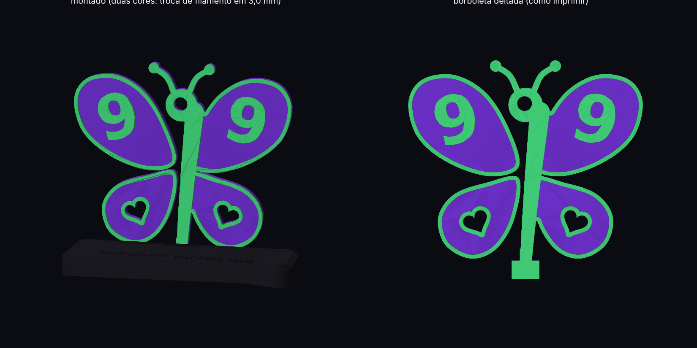

# 999 Butterfly — tributo ao Juice WRLD

Uma borboleta em que o **999** faz parte do próprio desenho dela:

- o **corpo é um 9** em pé: o laço vira a cabeça e a cauda vira o abdômen
- cada **asa de cima tem um 9** em relevo, então da esquerda pra direita se lê **9 9 9**
- as asas de baixo têm **corações vazados**
- ela encaixa numa base com **LEGENDS NEVER DIE** gravado na frente e **999** atrás



## Arquivos

| arquivo | o que é |
|---|---|
| `borboleta_999.stl` | a borboleta (102 × 95 × 4,2 mm) |
| `base.stl` | a base (108 × 34 × 10 mm) |
| `montado.stl` | as duas juntas, só pra visualizar (não imprimir) |
| `gerar.py` | script que gera tudo (dá pra mudar tamanho, folga, texto) |

## Como imprimir

**Borboleta**: imprima deitada, com o relevo virado pra cima, sem suporte.
- camada de 0,2 mm, 3 paredes, 20% de preenchimento
- **duas cores (recomendado):** a chapa tem 3,0 mm e o relevo vai de 3,0 até 4,2 mm.
  No fatiador, coloque uma **troca de filamento (M600 / "pause") na altura de 3,0 mm**.
  Fica bonito em roxo + verde neon, preto + branco ou preto + vermelho.

**Base**: imprima como está, sem suporte.
- as letras são gravadas 0,8 mm pra dentro. Pra destacar, pinte por cima com uma
  caneta posca/acrílica e passe um pano úmido: a tinta fica só dentro das letras.
  Também dá pra fazer troca de filamento em 9,2 mm se você quiser o fundo das letras de outra cor.

**Encaixe**: o rasgo tem 0,25 mm de folga. Se ficar frouxo, uma gota de cola resolve;
se ficar apertado, mude `FOLGA_ENCAIXE` no `gerar.py` e gere de novo.

## Gerar de novo / personalizar

```bash
pip install numpy shapely trimesh mapbox_earcut manifold3d matplotlib
python gerar.py
```

No começo do `gerar.py` ficam os parâmetros (espessura, altura do relevo, tamanho da base,
folga). A frase da base está na linha `texto("LEGENDS NEVER DIE", ...)`.

Peça de fã, sem fins comerciais. 999 forever.
